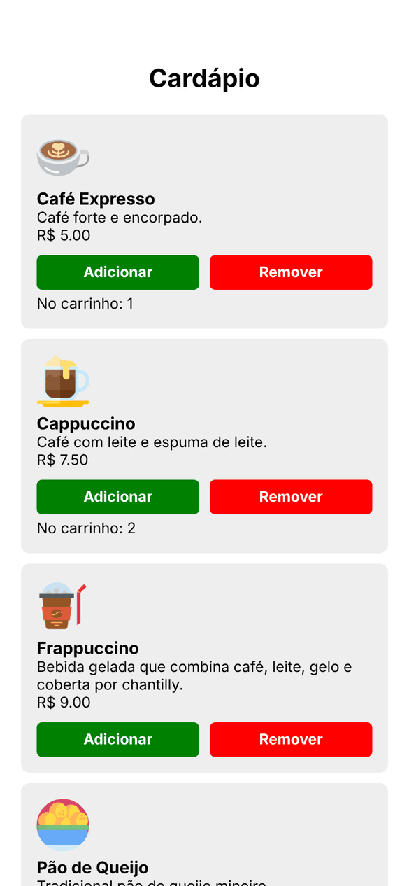
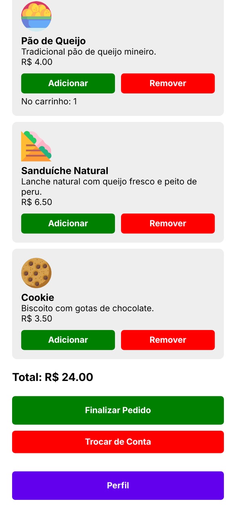
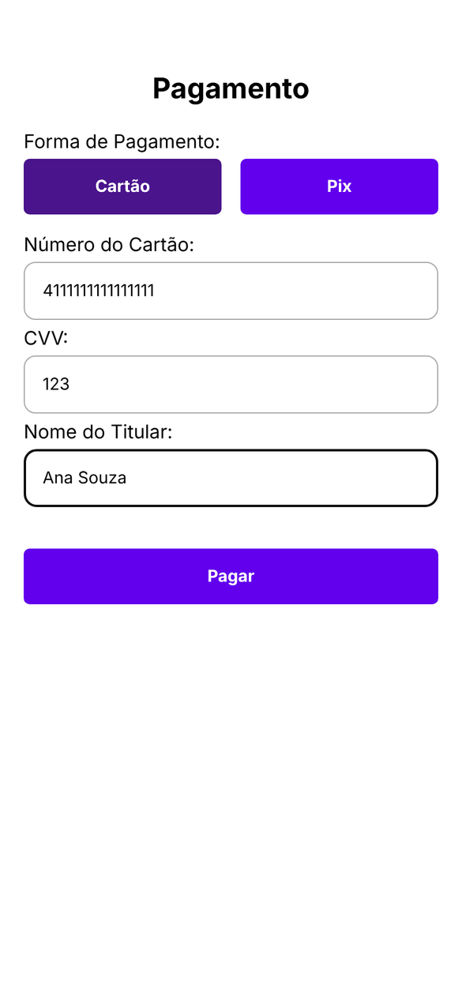
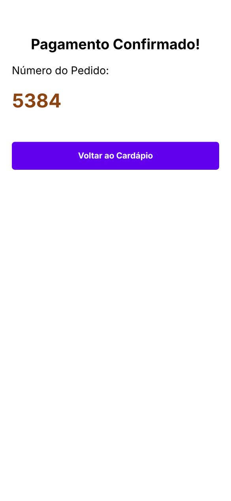
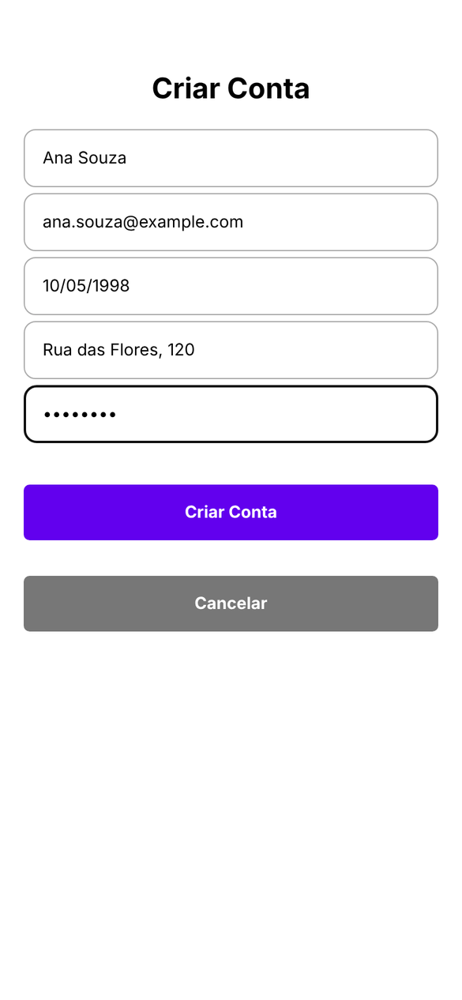
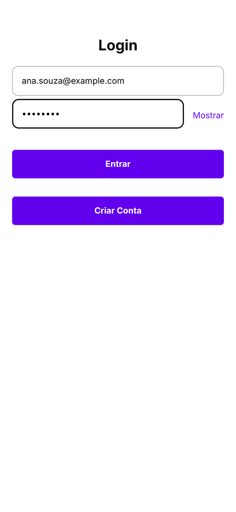
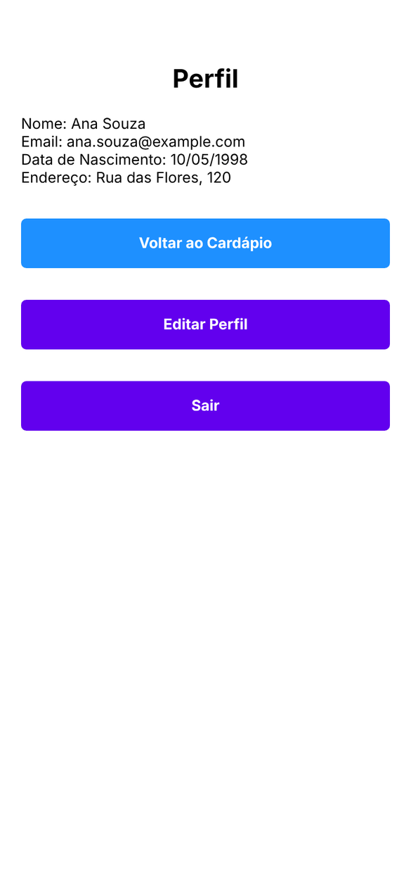
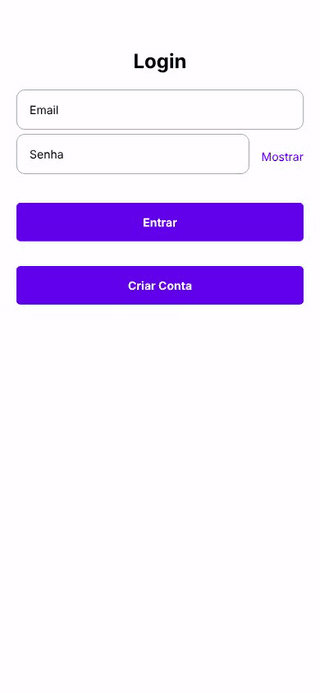

# Smoke Coffee

Ordering app for a coffee shop, built with React Native and Expo. Customers create an account, browse the menu, build a cart, pay with Pix or card and receive an order number. Everything runs on the device, with no backend.

The app interface is in Brazilian Portuguese.


## Screenshots

Captured from the web build in a phone-sized window (390x844).

| Menu | Cart total | Card payment | Order confirmation |
|---|---|---|---|
|  |  |  |  |

| Sign-up | Login | Profile |
|---|---|---|
|  |  |  |

Ordering flow: login, adding items to the cart, Pix payment and the order number.



## About

I built Smoke Coffee in August 2025 to practice a complete ordering flow in React Native: stack navigation, form validation, data saved on the device and local notifications. It is a study project, so payment and authentication are simulated (see [Limitations](#limitations)).

## Features

- Sign-up with required fields, email format check, a date of birth field that formats itself as DD/MM/YYYY and rejects impossible dates, a 4-character minimum password and a check for emails already registered.
- Login against the accounts saved on the device, with a show/hide password toggle.
- Menu with six items (espresso, cappuccino, frappuccino, pão de queijo, sandwich and cookie), each with image, description and price.
- Cart with add and remove buttons, quantity per item and a running total. Checkout is blocked while the cart is empty.
- Payment by card (number, CVV and cardholder name required) or Pix, followed by a confirmation screen with the order number.
- Two local notifications: a welcome message after login and an "order ready" alert after payment, both 5 seconds after the event.
- Profile screen with the account data, profile editing (name, date of birth, address and password) and logout.

## How it works

### Navigation

A single stack navigator ([`src/navigation/index.js`](src/navigation/index.js)) with headers hidden. Screens that close a step (splash, sign-up, login and payment) move on with `navigation.replace`, so the back button never returns to a finished step.

### Local data

AsyncStorage keeps two keys: `usuarios`, the list of accounts, and `usuarioLogado`, the email of the signed-in user. The profile and edit screens look up the account in that list by email.

### Notifications

[`src/services/notifications.js`](src/services/notifications.js) sets the notification handler when the app loads (`App.js` imports it), asks for permission, creates the Android channel and returns the Expo push token. The menu and confirmation screens schedule local notifications with `scheduleNotificationAsync`.

### Date input

`maskDateInput` in [`src/utils/formatters.js`](src/utils/formatters.js) adds the slashes while the user types. `isValidDateDDMMYYYY` builds a `Date` from the parts and checks that day, month and year come back unchanged, which rejects dates like 31/02.

## Limitations

This is a front-end study project. Before any real use it would need:

- a backend for accounts, since passwords are stored in plain text in AsyncStorage and compared on the device;
- a payment gateway, since payment is simulated: the card fields are only checked for being filled in, card data is not saved and Pix does not generate a QR code;
- a product API, since the menu is fixed in `src/data/products.js` and the images load from external URLs.

## Tech stack

- React Native 0.79 and React 19
- Expo SDK 53
- React Navigation 7 (stack navigator)
- AsyncStorage for local persistence
- expo-notifications
- ESLint with eslint-config-expo

## Project structure

```
.
├── App.js                  # entry point: navigation container and notification handler
├── app.json                # Expo config (name, icons, splash)
├── assets/images/          # app icon, adaptive icon, splash icon and favicon
└── src/
    ├── data/products.js    # menu items
    ├── navigation/         # stack navigator
    ├── screens/            # one file per screen
    ├── services/           # notification setup
    ├── styles/global.js    # shared StyleSheet
    └── utils/formatters.js # date mask and validation
```

Screen files keep Portuguese names: `CadastroScreen` (sign-up), `CardapioScreen` (menu and cart), `PagamentoScreen` (payment), `ConfirmacaoScreen` (order confirmation), `PerfilScreen` (profile) and `EditarPerfilScreen` (edit profile), plus `SplashScreen` and `LoginScreen`.

## Getting started

Requires Node.js 20 or newer, plus Expo Go, an Android emulator or the iOS simulator.

```bash
git clone https://github.com/PedroRossZny/smoke-coffee.git
cd smoke-coffee
npm install
npm start
```

`npm start` opens the Expo dev server. Scan the QR code with Expo Go, or press `a` for Android, `i` for iOS or `w` for the browser.

Expo Go from the app stores only runs the latest Expo SDK. If yours is newer than SDK 53, open the app on an Android emulator with `npm run android` (Expo installs a matching Expo Go there) or use the web version. Notifications are not available on the web.

| Script | What it does |
|---|---|
| `npm start` | starts the Expo dev server |
| `npm run android` | opens the app on an Android emulator or device |
| `npm run ios` | opens the app on the iOS simulator (macOS only) |
| `npm run web` | opens the app in the browser |
| `npm run lint` | runs ESLint |

## Credits

Menu icons from [Flaticon](https://www.flaticon.com). The splash screen background is a photo loaded from lahora.com.ec.

## License

The code is released under the [MIT License](LICENSE). Icons and photos belong to their owners and are not covered by it.

## Author

Pedro Ross. [GitHub](https://github.com/PedroRossZny) | [LinkedIn](https://www.linkedin.com/in/pedro-ross)
